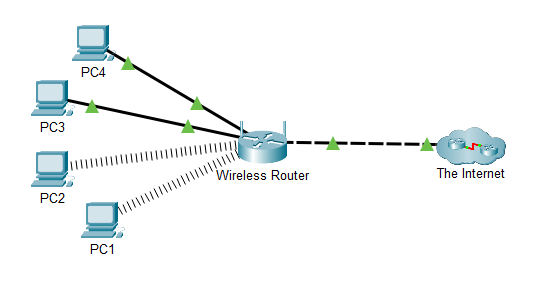
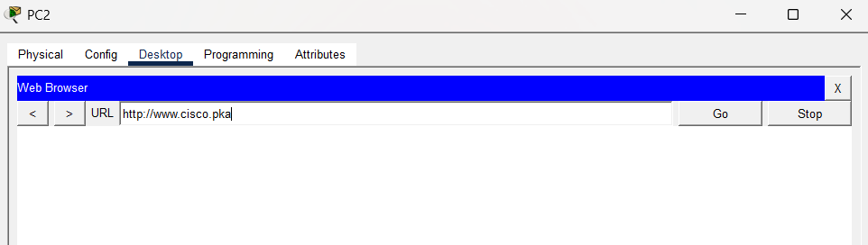
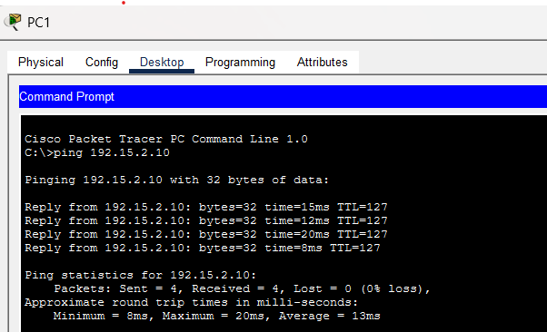
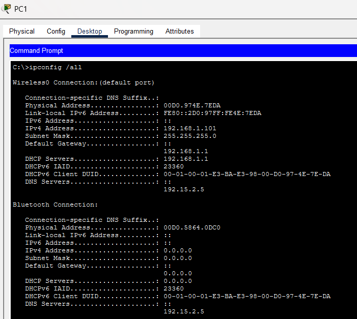
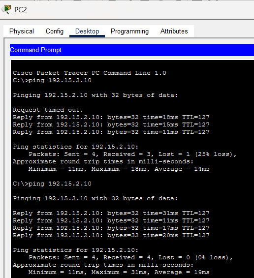
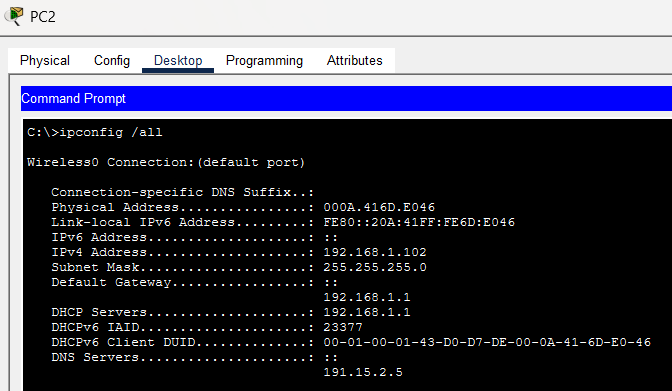
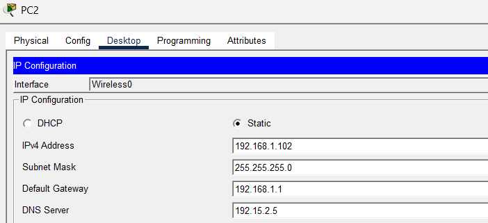
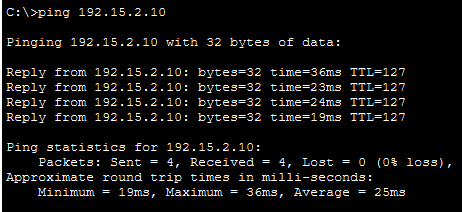
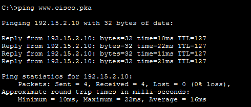
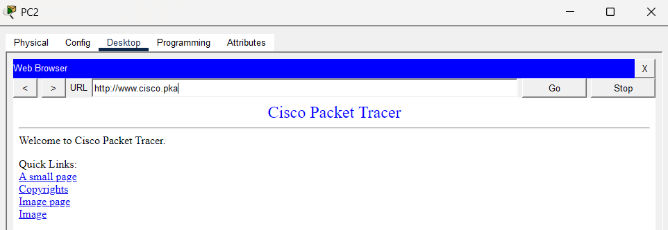

# Lab 01: Use the `ping` Command

## 1. Aim

To use the `ping` command and network configuration details to identify and troubleshoot a PC configuration error that prevents access to a website in Cisco Packet Tracer.

## 2. Objectives

- Verify connectivity between PCs and a web server.
- Identify the PC that cannot access the website.
- Use `ping` to test connectivity by hostname and IP address.
- Use `ipconfig /all` to inspect network configuration.
- Compare the configuration of a working PC with the affected PC.
- Correct the DNS server address and verify the solution.

## 3. Software and Tools Required

- Cisco Packet Tracer
- PCs and a wireless router
- Internet and web server simulation
- Command Prompt
- Web Browser

## 4. Topology

The network consists of four PCs connected to a wireless router, which connects to the Internet.



### Devices Used

| Device | Purpose |
|---|---|
| PC1 | Working PC used for comparison |
| PC2 | Affected PC used for troubleshooting |
| PC3 | Client computer |
| PC4 | Client computer |
| Wireless Router | Connects the PCs to the network |
| Internet | Represents the external network and web server |

## 5. Background and Scenario

A small business reports that some users cannot access a website. The PCs have network configurations that need to be checked.

The task is to identify the problem using connectivity tests, compare the network settings of a working PC and the affected PC, and make the necessary configuration correction.

The affected computer identified in the supplied activity is PC2.

## 6. Important Networking Concepts

### 6.1 Ping Command

The `ping` command tests whether a destination can be reached over an IP network. It sends ICMP Echo Request messages and waits for Echo Replies.

Example:

```text
ping 192.15.2.10
```

A successful ping indicates IP-level reachability for that test. A failed ping does not always mean that the destination is unavailable, because ICMP traffic may be blocked or packets may be lost.

### 6.2 DNS (Domain Name System)

DNS translates domain names into IP addresses.

For example:

```text
www.cisco.pka -> 192.15.2.10
```

If the DNS server is configured incorrectly, a PC may be unable to resolve a website's name even when it can reach the server directly by IP address.

### 6.3 IP Configuration

A PC's network configuration commonly includes:

- IPv4 address
- Subnet mask
- Default gateway
- DNS server address

The `ipconfig /all` command displays detailed network configuration information.

## 7. Commands Used

| Command | Purpose |
|---|---|
| `ping www.cisco.pka` | Tests connectivity using the website's hostname |
| `ping 192.15.2.10` | Tests connectivity directly to the web server's IP address |
| `ipconfig /all` | Displays IP addressing, gateway, and DNS information |

The web server IP address shown in the supplied activity is `192.15.2.10`.

## 8. Procedure

### Part 1: Verify Connectivity

1. Allow all Packet Tracer devices to complete their boot process.
2. Open each PC.
3. Navigate to **Desktop > Web Browser**.
4. Enter the URL:

   ```text
   http://www.cisco.pka
   ```

5. Observe which PCs can access the website.
6. Record the affected PC.

**Observation:** PC2 is identified as unable to access the website in the supplied activity.



### Part 2: Ping the Web Server from PC1

1. Open PC1.
2. Select **Desktop > Command Prompt**.
3. Execute:

   ```text
   ping 192.15.2.10
   ```

4. Observe the replies and packet statistics.
5. Run the following command:

   ```text
   ipconfig /all
   ```

6. Record PC1's IPv4 address, subnet mask, default gateway, and DNS server.

**Observed result from the screenshot:**

- Four ping replies were received.
- Packets received: 4
- Packet loss: 0%
- IPv4 address: `192.168.1.101`
- Subnet mask: `255.255.255.0`
- Default gateway: `192.168.1.1`
- DNS server: `192.15.2.5`



### Part 3: Ping the Web Server from PC2

1. Open PC2.
2. Select **Desktop > Command Prompt**.
3. Execute:

   ```text
   ping 192.15.2.10
   ```

4. Examine the replies.
5. Repeat the command if required.
6. Run:

   ```text
   ipconfig /all
   ```

7. Record PC2's network settings.

**Observed result from the screenshot:**

During the first ping test, PC2 received three replies and one request timed out. A subsequent ping test received four replies.

This shows that PC2 can reach the web server by IP address, although the first test experienced one lost packet.

### Part 4: Compare the Network Configurations

Run `ipconfig /all` on both PC1 and PC2 and compare their network settings.

| Configuration | PC1 | PC2 |
|---|---|---|
| IPv4 address | `192.168.1.101` | `192.168.1.102` |
| Subnet mask | `255.255.255.0` | `255.255.255.0` |
| Default gateway | `192.168.1.1` | `192.168.1.1` |
| DNS server | `192.15.2.5` | `191.15.2.5` |


**Finding:**

The DNS server address on PC2 is different from the DNS server address on PC1.

- PC1 DNS server: `192.15.2.5`
- PC2 DNS server: `191.15.2.5`

The first octet of PC2's DNS server address is incorrect compared with the working PC's configuration.

### Part 5: Correct the DNS Configuration

1. Open PC2.
2. Select **Desktop > IP Configuration**.
3. Locate the DNS Server field.
4. Replace the incorrect address:

   ```text
   191.15.2.5
   ```

   with the correct address:

   ```text
   192.15.2.5
   ```

5. Leave the IPv4 address, subnet mask, and default gateway unchanged.
6. Confirm that the DNS field displays the corrected address.

### Part 6: Verify the Correction

After correcting the DNS server:

1. Open **Desktop > Command Prompt** on PC2.
2. Execute:

   ```text
   ping 192.15.2.10
   ```

3. Test name resolution and connectivity:

   ```text
   ping www.cisco.pka
   ```

4. Open **Desktop > Web Browser**.
5. Enter:

   ```text
   http://www.cisco.pka
   ```

6. Verify whether the webpage loads.
7. Capture screenshots of the corrected DNS setting, successful hostname ping, and working webpage.

**Expected result:** The hostname should resolve to `192.15.2.10`, and the website should load if DNS and the web service are functioning correctly.

Record the actual post-correction results before marking the activity as fully verified.

## 9. Results and Observations

| Test | Observed result |
|---|---|
| PC1 ping to `192.15.2.10` | Four replies received, 0% packet loss |
| PC2 first ping to `192.15.2.10` | Three replies received, one request timed out |
| PC2 second ping to `192.15.2.10` | Four replies received |
| PC1 DNS server | `192.15.2.5` |
| PC2 DNS server before correction | `191.15.2.5` |
| Correct DNS server for PC2 | `192.15.2.5` |
| Final hostname ping and browser test | To be verified after correction |

## 10. Troubleshooting Analysis

The ping test to the web server's IP address succeeds from PC2, showing that the server is reachable by IP address during the test.

However, the DNS server configured on PC2 differs from the working PC's DNS server.

When a user enters a domain name in a browser, the PC needs to resolve that name to an IP address. An incorrect DNS server setting can prevent this process from working properly.

Therefore, the DNS server mismatch is the likely cause of the website access issue.

A final hostname ping and browser test should be performed after the correction to confirm the solution.

## 11. Conclusion

The lab successfully demonstrated how the `ping` command and `ipconfig /all` can be used to troubleshoot network connectivity. The issue was traced to an incorrect DNS server address on PC2. After correcting the DNS server to `192.15.2.5`, the hostname ping and website access tests completed successfully. This confirmed that the DNS configuration error had been resolved.

## 12. Evidence Checklist


## Before Correction

### PC2 Browser Failure


### PC1 Successful Ping


### PC1 Network Configuration


### PC2 Ping Test


### PC2 Incorrect DNS Configuration


## After Correction

### Corrected DNS Configuration


### Successful Ping to Server IP


### Successful Ping by Hostname


### Successful Website Access



## 13. Skills Learned

- Using `ping` to test network connectivity
- Understanding DNS name resolution
- Inspecting network configuration using `ipconfig /all`
- Comparing network settings between devices
- Identifying a DNS configuration error
- Verifying network troubleshooting changes

---

**Platform:** Cisco Packet Tracer  
**Lab:** Use the `ping` Command  
**Purpose:** Educational networking practice
