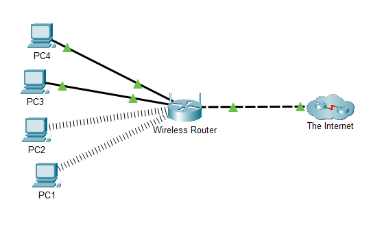
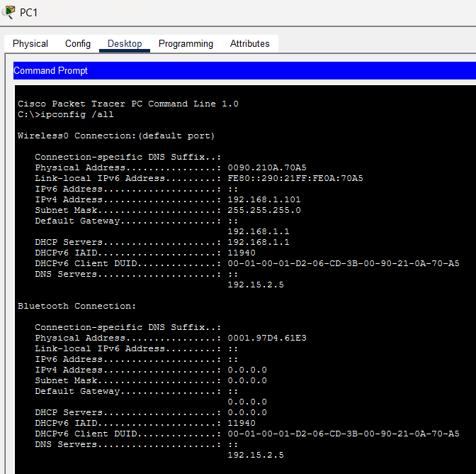
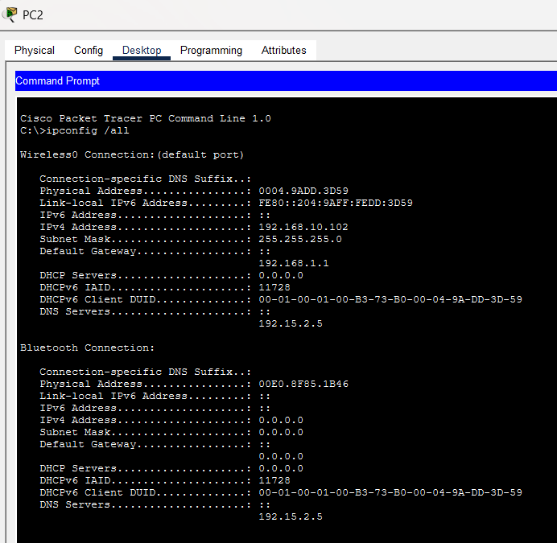
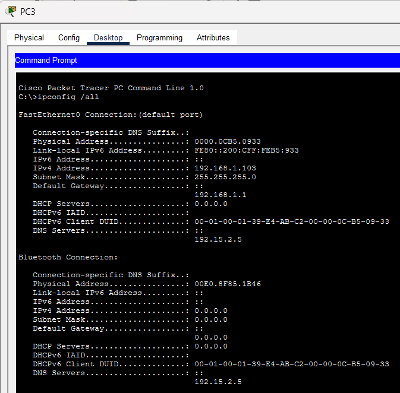
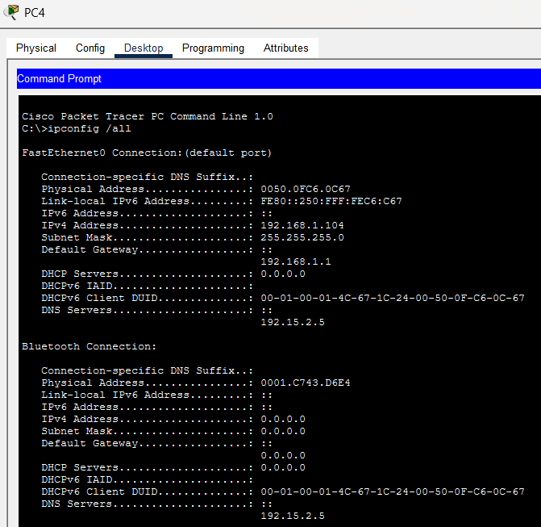
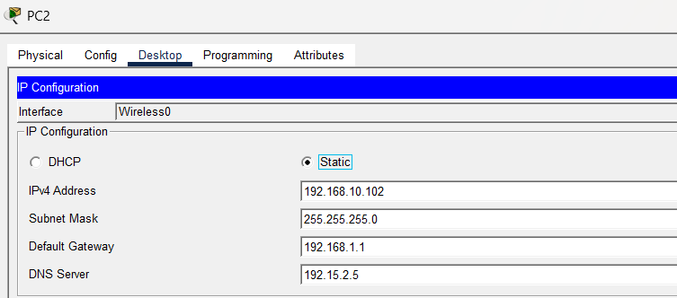
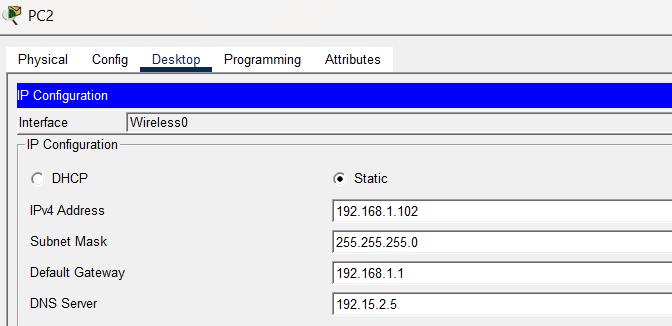
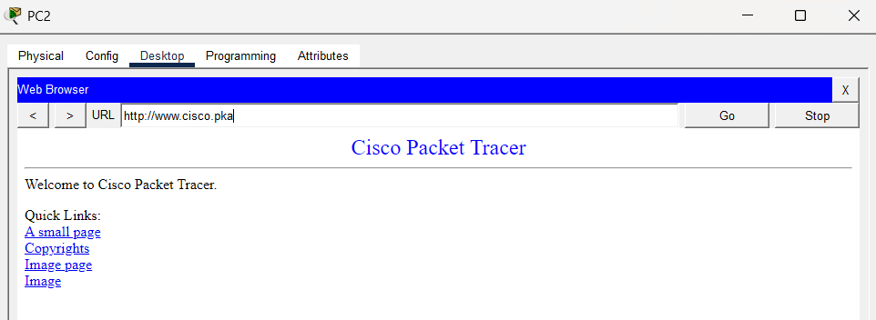

# Lab 02: Use the `ipconfig` Command

## Aim

To use the `ipconfig /all` command in Cisco Packet Tracer to identify an incorrectly configured PC and correct its IP address to restore network access.

## Objectives

- Understand the purpose of the `ipconfig` command.
- Display detailed network settings using `ipconfig /all`.
- Identify an incorrect IPv4 address.
- Correct the IP configuration of a PC.
- Verify network connectivity and website access after correction.

## Network Topology

The network consists of four PCs connected to a wireless router. The router provides connectivity to the Internet. The PCs are configured to use the `192.168.1.0/24` network.



## Background / Scenario

A small business owner cannot access the `www.cisco.pka` website from one of the four PCs in the office. The PCs are expected to use IP addresses belonging to the `192.168.1.0/24` network.

The `ipconfig /all` command is used to examine the network configuration of each PC and identify the source of the problem.

## Commands Used

### 1. `ipconfig`

Displays the basic IP configuration of a PC, including its IPv4 address, subnet mask, and default gateway.

```bash
ipconfig
```

### 2. `ipconfig /all`

Displays detailed network configuration information, including the physical address, IPv4 address, subnet mask, default gateway, DHCP information, and DNS server.

```bash
ipconfig /all
```

### 3. `ping`

Tests connectivity between a PC and another network device or server.

```bash
ping 192.15.2.10
```

## Procedure

1. Open the network topology in Cisco Packet Tracer.
2. Select PC1 and navigate to **Desktop → Command Prompt**.
3. Execute `ipconfig /all` and record its network configuration.
4. Repeat the same procedure for PC2, PC3, and PC4.
5. Compare the IPv4 addresses, subnet masks, default gateways, and DNS server settings.
6. Identify the PC with an incorrect IPv4 address.
7. Select PC2 and open **Desktop → IP Configuration**.
8. Change the incorrect IPv4 address from `192.168.10.102` to `192.168.1.102`.
9. Verify that the subnet mask, default gateway, and DNS server are configured correctly.
10. Open the web browser on PC2 and access `www.cisco.pka`.
11. Confirm that the website opens successfully.

## IP Configuration Results

The following table summarizes the configurations observed in the screenshots.

| PC | IPv4 Address | Subnet Mask | Default Gateway | DNS Server |
|---|---|---|---|---|
| PC1 | `192.168.1.101` | `255.255.255.0` | `192.168.1.1` | `192.15.2.5` |
| PC2 | `192.168.1.102` after correction | `255.255.255.0` | `192.168.1.1` | `192.15.2.5` |
| PC3 | `192.168.1.103` | `255.255.255.0` | `192.168.1.1` | `192.15.2.5` |
| PC4 | `192.168.1.104` | `255.255.255.0` | `192.168.1.1` | `192.15.2.5` |

## Screenshots: IP Configuration of All PCs

### PC1 — IP Configuration



### PC2 — IP Configuration



### PC3 — IP Configuration



### PC4 — IP Configuration



## Problem Identification

PC2 was unable to access the `www.cisco.pka` website. After examining the network settings using `ipconfig /all`, its IPv4 address was identified as incorrect.

The configured address was `192.168.10.102`, whereas the intended network was `192.168.1.0/24`.

### PC2 Before Correction

The incorrect IPv4 address was:

- IPv4 address: `192.168.10.102`
- Subnet mask: `255.255.255.0`
- Default gateway: `192.168.1.1`
- DNS server: `192.15.2.5`



## Solution

The following steps were performed to correct the problem:

1. Selected PC2 in Cisco Packet Tracer.
2. Opened **Desktop → IP Configuration**.
3. Changed the IPv4 address from `192.168.10.102` to `192.168.1.102`.
4. Kept the subnet mask as `255.255.255.0`.
5. Kept the default gateway as `192.168.1.1`.
6. Kept the DNS server as `192.15.2.5`.
7. Opened the web browser and accessed `www.cisco.pka`.

### PC2 After Correction

The corrected IPv4 address was `192.168.1.102`, which belongs to the intended `192.168.1.0/24` network.



## Verification

After correcting the IP address, the website was opened successfully on PC2.

### Successful Website Access



This confirms that correcting PC2's IPv4 address resolved the reported website-access problem.

## Result

The incorrect IPv4 address on PC2 was identified using the `ipconfig /all` command and corrected from `192.168.10.102` to `192.168.1.102`. After the correction, PC2 successfully accessed the `www.cisco.pka` website.

## Conclusion

This lab demonstrated how the `ipconfig /all` command can be used to inspect network configuration and troubleshoot connectivity problems. By identifying and correcting PC2's incorrect IPv4 address, access to the website was restored successfully.
