# Lab 03: Create a LAN

## Overview
This lab demonstrates how to create a Local Area Network (LAN) in Cisco Packet Tracer by connecting end devices, configuring IPv4 addressing, and verifying connectivity between devices and the Internet.

## Objectives
- Connect network devices and end hosts.
- Configure PCs to receive IPv4 addresses through DHCP.
- Configure a printer with a static IPv4 address.
- Verify network connectivity using `ping`.
- Inspect network configuration using `ipconfig` and `ipconfig /all`.
- Trace the route to a remote server using `tracert`.

## Network Topology
The network consists of:
- Office Router
- Network Switch
- Admin PC
- Manager PC
- Printer
- ISP/Internet connection
- Web server (`www.cisco.pt`)

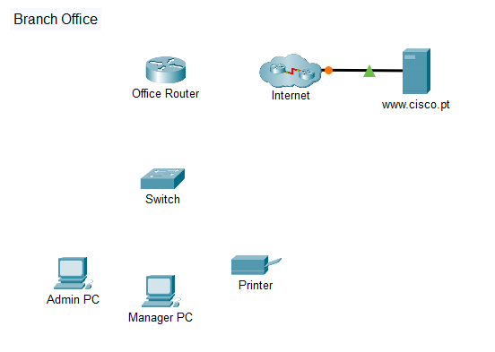

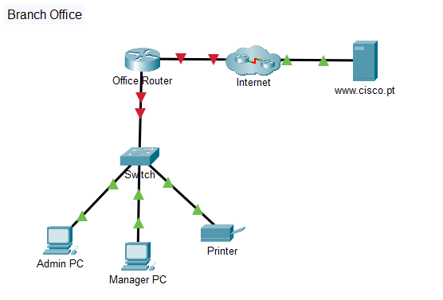

## Addressing Table

| Device | IPv4 Address | Subnet Mask | Addressing Method |
|---|---|---|---|
| Admin PC | Assigned by DHCP | 255.255.255.0 | Dynamic |
| Manager PC | Assigned by DHCP | 255.255.255.0 | Dynamic |
| Printer | 192.168.1.100 | 255.255.255.0 | Static |
| Office Router LAN interface | Verify in Packet Tracer | 255.255.255.0 | Configured on router |
| Web server (`www.cisco.pt`) | 209.165.200.225 | N/A | As configured in the activity |

## Procedure

### 1. Connect the Devices
- Connect the Office Router's G0/0 interface to ISP1's G0/0 interface.
- Connect the Office Router's G0/1 interface to the switch's G0/1 interface.
- Connect the Admin PC to switch port F0/1.
- Connect the Manager PC to switch port F0/2.
- Connect the printer to switch port F0/24.
- Use copper straight-through cables for the Ethernet connections.
- Verify that the link indicators become green.

### 2. Configure IPv4 Addressing
Configured the Admin PC and Manager PC to obtain their IPv4 settings through DHCP. Configured the printer with the static address `192.168.1.100` and subnet mask `255.255.255.0`.

### 3. Verify the PC Configuration
Used the following command to inspect the IP configuration:

```text
ipconfig /all
```

Initially, the PCs displayed automatic IPv4 addresses beginning with `169.254`. This indicated that they had not successfully obtained IPv4 addresses through DHCP.

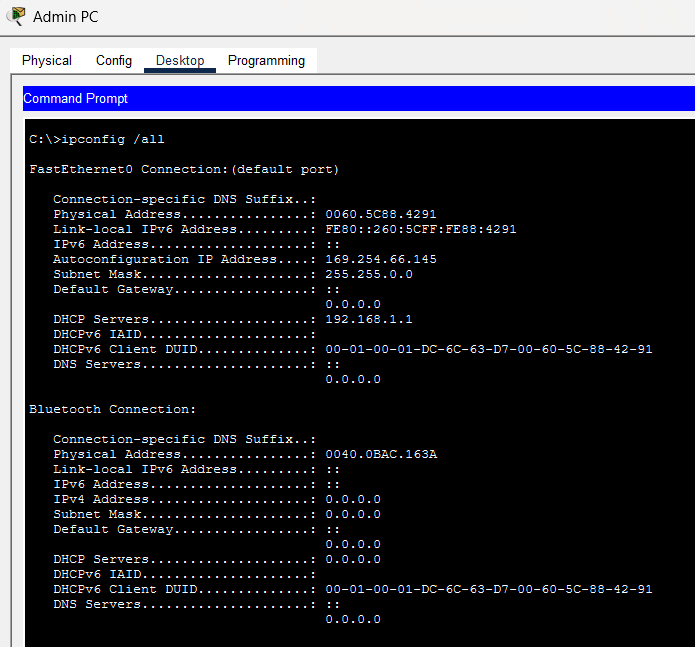

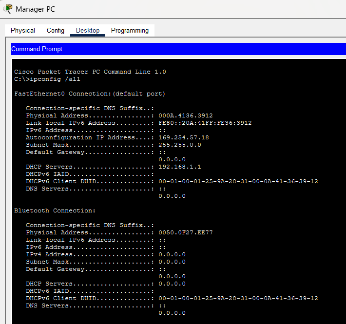

After correcting the network configuration, verified that both PCs received valid addresses on the `192.168.1.0/24` network.

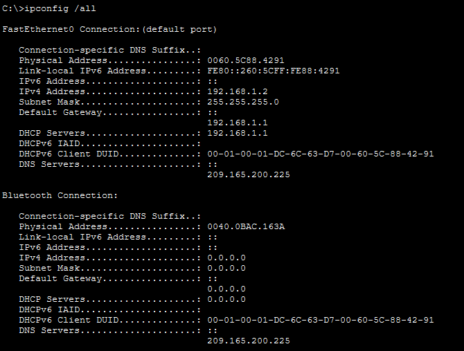

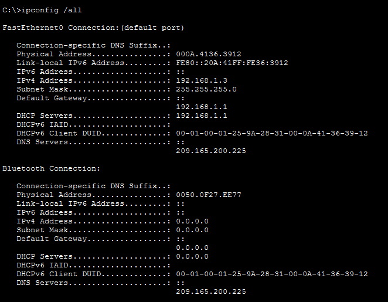

### 4. Configure the Printer
Configured the printer with its assigned static IPv4 address and subnet mask.

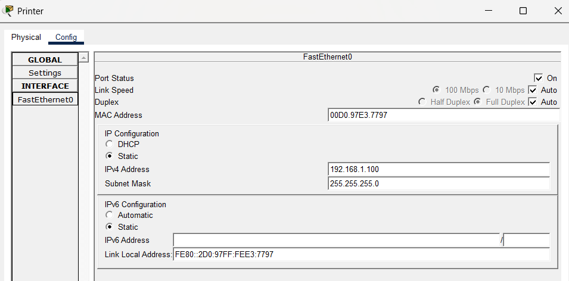

### 5. Test Local Network Connectivity
Used `ping` to test communication between the PCs and the printer.

```text
ping 192.168.1.100
```

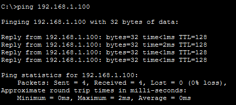

### 6. Verify Internet Connectivity
Tested access to the Internet server using its IP address and hostname.

- Server IP: `209.165.200.225`
- Server hostname: `www.cisco.pt`

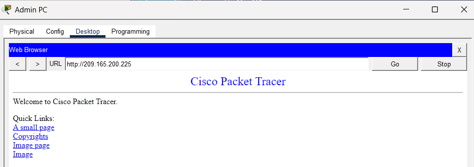

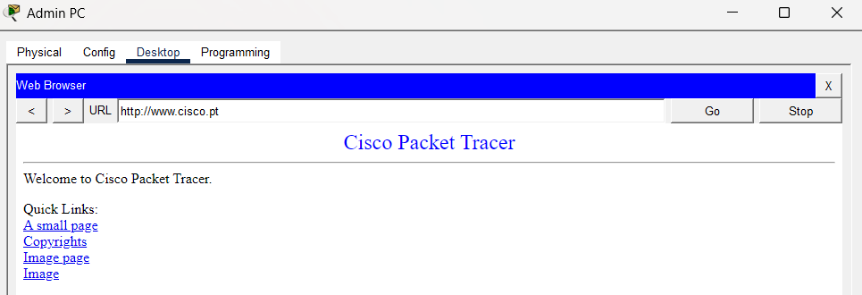

### 7. Trace the Network Route
Used `tracert` to examine the route packets take to reach the remote web server.

```text
tracert www.cisco.pt
```

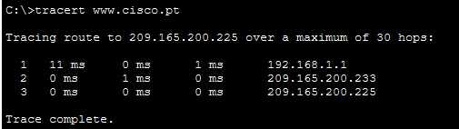

## Results
The lab demonstrates device connectivity, IPv4 configuration, DHCP troubleshooting, static IP configuration, and network connectivity testing. Record the final ping and browser results based on the actual Packet Tracer tests performed.

## Commands Used

| Command | Purpose |
|---|---|
| `ipconfig` | Displays basic IP configuration |
| `ipconfig /all` | Displays detailed network configuration |
| `ping 192.168.1.100` | Tests connectivity to the printer |
| `tracert www.cisco.pt` | Traces the route to the web server |

## Conclusion
This lab provides practical experience in building a LAN, configuring IPv4 addressing, troubleshooting DHCP-related issues, and verifying local and remote network connectivity using Cisco Packet Tracer.
