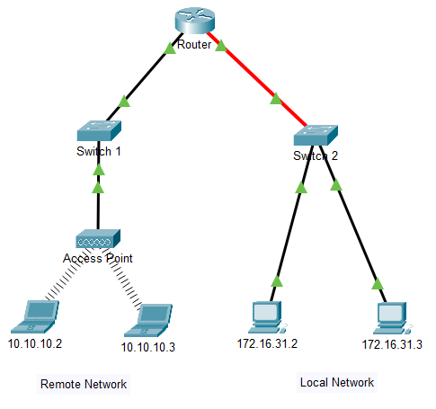
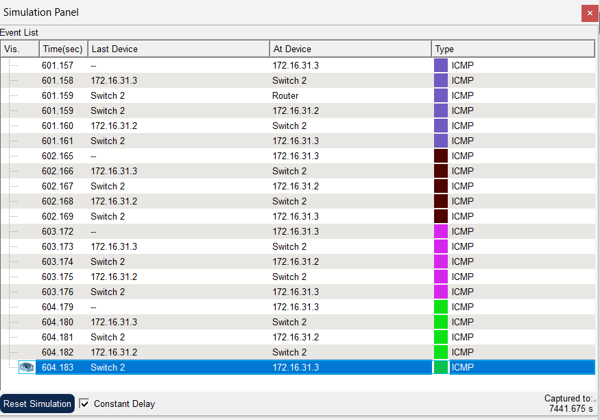
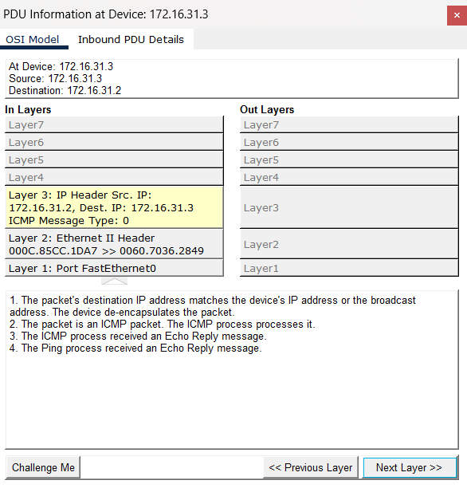
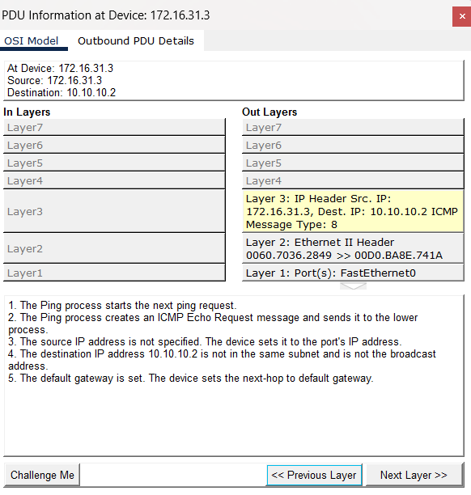
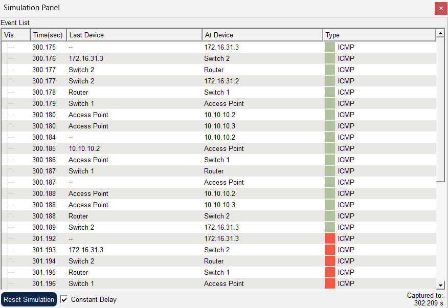

# Packet Tracer – Identify MAC and IP Addresses

## Overview

This Cisco Packet Tracer lab demonstrates how MAC addresses and IPv4 addresses are used when devices communicate over a network. Using Simulation Mode, we inspect the details of Protocol Data Units (PDUs) as they travel between devices on the same local network and between devices on different networks.

## Objectives

- Gather PDU information for local network communication.
- Gather PDU information for remote network communication.
- Identify source and destination MAC addresses.
- Identify source and destination IPv4 addresses.
- Understand how switches and routers handle Ethernet frames and IP packets.

## Tools and Technologies

- Cisco Packet Tracer
- IPv4 addressing
- Ethernet and MAC addressing
- ICMP (`ping`)
- Simulation Mode
- OSI model

## Network Topology

### Part 1: Local Network Communication

The first topology contains two PCs on the same local network, connected through a switch. The activity uses PC `172.16.31.3` to ping PC `172.16.31.2`.



### Part 2: Remote Network Communication

The second topology contains devices on different IP networks connected through switches, an access point, and a router. The activity uses PC `172.16.31.3` to ping the remote host `10.10.10.2`.


## Part 1: Gather PDU Information for Local Network Communication

### Procedure

1. Open PC `172.16.31.3` and launch Command Prompt.
2. Run the command:

   ```text
   ping 172.16.31.2
   ```

3. Switch to **Simulation Mode** and repeat the ping command.
4. Select the PDU envelope that appears beside the source PC.
5. Inspect the **OSI Model** and **Outbound PDU Details** tabs.
6. Record the source and destination MAC and IPv4 addresses.
7. Use **Capture / Forward** to follow the PDU through the switch until it reaches the destination.

### Observations

For local communication, the source and destination PCs belong to the same IP network. The source sends an Ethernet frame addressed to the destination PC's MAC address. The switch forwards the frame toward the correct port.

The IPv4 source and destination addresses identify the two communicating PCs. Because the destination is on the same local network, the source does not need to send the frame to the default gateway.



### Local Network: PDU Details

The PDU Information window displays the ICMP echo reply received by PC `172.16.31.3` from PC `172.16.31.2`.



The packet contains the following addressing information:

| Field | Observed value |
|---|---|
| Device receiving the reply | `172.16.31.3` |
| Source IPv4 address | `172.16.31.2` |
| Destination IPv4 address | `172.16.31.3` |
| Source MAC address | `000C.85CC.1DA7` |
| Destination MAC address | `0060.7036.2849` |
| ICMP message type | `0` — Echo Reply |
| Network interface | `FastEthernet0` |

**Observation:** The echo reply has the source and destination IP addresses reversed compared with the original echo request. The Ethernet header also identifies the sender and receiver on the local link. This demonstrates how ICMP and Ethernet addressing work together during local network communication.

## Part 2: Gather PDU Information for Remote Network Communication

### Procedure

1. Return to the Command Prompt on PC `172.16.31.3`.
2. Run the command:

   ```text
   ping 10.10.10.2
   ```

3. Switch to **Simulation Mode** and repeat the command.
4. Select the PDU and inspect its source and destination MAC and IPv4 addresses.
5. Use **Capture / Forward** to follow the PDU as it passes through the switch and router.
6. Record the addressing information for the inbound and outbound PDUs at the router.
7. Continue following the PDU toward the destination and observe the echo reply returning to the source.

### Observations

For remote communication, the destination belongs to a different IP network. The source sends the Ethernet frame to the MAC address of its default gateway. The router examines the destination IP address and forwards the packet toward the remote network.

As the packet moves between networks, the source and destination MAC addresses change for each Ethernet link. The source and destination IPv4 addresses generally remain the same from the original sender to the final destination, unless a feature such as NAT modifies them.

### Remote Network: Outbound PDU Details at the Source PC

The PDU Information window shows the ICMP Echo Request created by PC `172.16.31.3` for the remote destination `10.10.10.2`.



| Field | Observed value |
|---|---|
| Source IPv4 address | `172.16.31.3` |
| Destination IPv4 address | `10.10.10.2` |
| Source MAC address | `0060.7036.2849` |
| Destination MAC address | `00D0.BA8E.741A` |
| ICMP message type | `8` — Echo Request |
| Outgoing interface | `FastEthernet0` |

**Observation:** Since `10.10.10.2` belongs to a different IP network, the source PC forwards the Ethernet frame to its default gateway. The destination IPv4 address remains that of the remote host, while the destination MAC address identifies the next-hop router on the local link.



## Key Concepts Learned

- **MAC address:** A Layer 2 address used to deliver Ethernet frames across a local link.
- **IPv4 address:** A Layer 3 logical address used to identify source and destination hosts across IP networks.
- **Switch:** Forwards Ethernet frames within a LAN using MAC address information.
- **Router:** Connects different IP networks and forwards packets based on IP routing information.
- **ICMP:** A protocol used by `ping` to send echo requests and receive echo replies.
- **Simulation Mode:** Allows the movement and details of PDUs to be inspected step by step.
- **Local communication:** The frame is addressed to the destination device's MAC address.
- **Remote communication:** The first Ethernet frame is addressed to the default gateway's MAC address.

## Conclusion

This lab demonstrates the difference between MAC addressing and IPv4 addressing during local and remote communication. By examining PDUs in Packet Tracer Simulation Mode, we can observe how switches forward frames within a LAN and how routers forward packets between networks. This helps explain the role of Layer 2 and Layer 3 addressing in computer networking.

## Skills Practiced

- Using the `ping` command
- Inspecting PDUs in Simulation Mode
- Identifying MAC and IPv4 addresses
- Observing switch and router forwarding
- Comparing local and remote network communication
