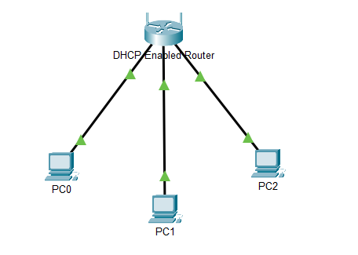

# Configure DHCP on a Wireless Router

## Aim
To configure DHCP on a wireless router in Cisco Packet Tracer, assign IP addresses automatically to three PCs, and verify network connectivity.

## Objectives
- Connect three PCs to a wireless router.
- Observe the default DHCP configuration.
- Change the router's IP address.
- Configure a specific DHCP address range.
- Enable DHCP on all three PCs.
- Verify connectivity using the `ping` command.

## Tools Used
- Cisco Packet Tracer
- Wireless router with DHCP support
- Three PCs
- Ethernet straight-through cables
- Command Prompt and web browser

## Network Topology

The network consists of one DHCP-enabled wireless router connected to three PCs: PC0, PC1, and PC2.



## Background

DHCP (Dynamic Host Configuration Protocol) automatically assigns IP configuration to devices on a network. This configuration can include an IP address, subnet mask, default gateway, and DNS server.

A DHCP server helps avoid manual IP configuration and reduces the possibility of address conflicts.

In this lab, the wireless router acts as the DHCP server.

## Procedure

### Part 1: Set Up the Network Topology

1. Add one wireless router and three PCs to the Packet Tracer workspace.
2. Connect each PC to an Ethernet port on the router using straight-through cables.
3. Wait for the link indicators to become green.

### Part 2: Observe the Default DHCP Settings

1. Open PC0.
2. Select **Desktop → IP Configuration**.
3. Select **DHCP**.
4. Observe the automatically assigned network settings.
5. Record the default gateway.

**Observed default gateway:** `192.168.0.1`

### Part 3: Change the Router's IP Address

1. Open PC0's **Desktop → Web Browser**.
2. Enter `http://192.168.0.1` in the address bar.
3. Log in using the credentials specified in the lab instructions.
4. Open the router's basic setup page.
5. Change the router's IP address to `192.168.5.1`.
6. Save the settings.
7. Close the browser if the page becomes unavailable after the change.
8. Return to PC0's IP Configuration and renew its address by selecting **Static** and then **DHCP**.
9. Open the router's new address, `http://192.168.5.1`, if further configuration is required.

### Part 4: Change the DHCP Address Range

1. Open the router's basic setup page at `http://192.168.5.1`.
2. Locate the DHCP Server settings.
3. Set the starting IP address to `192.168.5.126`.
4. Set the maximum number of DHCP users as required by the lab.
5. Save the settings.
6. Renew PC0's address by selecting **Static** and then **DHCP**.
7. Use `ipconfig` in the Command Prompt to check the assigned address.

**Expected PC0 IP address:** `192.168.5.126`

### Part 5: Enable DHCP on the Other PCs

1. Open PC1.
2. Select **Desktop → IP Configuration**.
3. Select **DHCP**.
4. Record the assigned IP address.
5. Repeat the same steps on PC2.

**Expected PC1 IP address:** `192.168.5.127`

PC2 should also receive an address automatically from the configured DHCP pool. Record the actual address displayed in Packet Tracer.

### Part 6: Verify Connectivity

1. Open PC2 and select **Desktop → Command Prompt**.
2. Enter `ipconfig` to check its IP configuration.
3. Ping the router:

   ```text
   ping 192.168.5.1
   ```

4. Ping PC1:

   ```text
   ping 192.168.5.127
   ```

5. Check whether the ping requests receive replies.

Note: The first ping can occasionally time out while address resolution takes place. Repeat the test if necessary.

## Expected Results

| Device | Expected IPv4 address |
|---|---|
| Router | `192.168.5.1` |
| PC0 | `192.168.5.126` |
| PC1 | `192.168.5.127` |
| PC2 | Record the address assigned by DHCP |

The router should assign IP addresses automatically from the configured DHCP pool, and the PCs should be able to communicate with the router and other PCs.

## Result

The wireless router's IP address and DHCP address range were configured in Cisco Packet Tracer. The PCs were configured to obtain their IP addresses automatically, and connectivity was tested using the `ping` command.

## Key Learnings

- DHCP automatically assigns IP addresses to network devices.
- A router's LAN IP address acts as the default gateway for connected PCs.
- DHCP address pools must use the correct network range.
- The `ipconfig` command displays a PC's network configuration.
- The `ping` command helps verify connectivity between devices.
