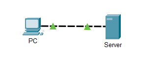
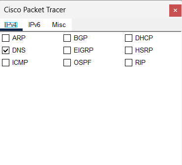
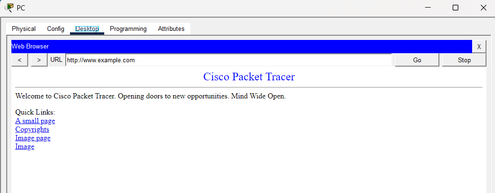
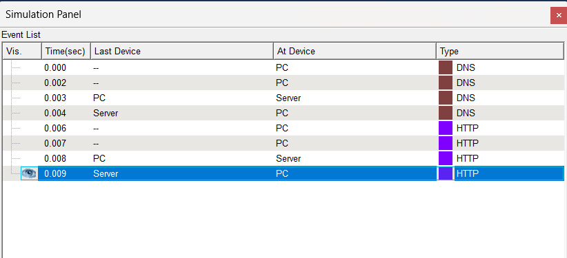
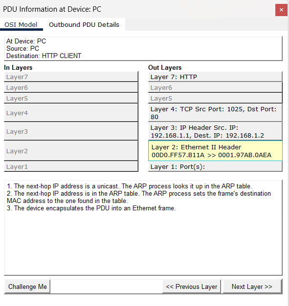

# Packet Tracer – The Client Interaction

## Overview
This lab demonstrates how a client PC communicates with a web server to request and receive a web page. Cisco Packet Tracer's Simulation Mode is used to observe DNS and HTTP traffic and examine packets as they move through the network.

## Objectives
- Understand client-server interaction.
- Observe DNS and HTTP events in Simulation Mode.
- Learn how a domain name is resolved into an IP address.
- Examine PDU information and OSI model layers.
- Understand how a web page is requested and delivered.

## Background
When a user enters a website address in a browser, the client may first use DNS to resolve the domain name into an IP address. The client then sends an HTTP request to the web server. The server responds with the requested web page, and the client acknowledges the data received.

Packet Tracer allows this exchange to be observed through its Simulation Mode and PDU Information window.

## Network Topology

## Lab Procedure

### Part 1: Enter Simulation Mode
1. Open the Packet Tracer project.
2. Switch from Realtime Mode to Simulation Mode.
3. Observe the Event List in the Simulation Panel.

### Part 2: Set Event List Filters
1. Clear the existing event filters using **Show All/None**.
2. Open **Edit Filters**.
3. Under the IPv4 tab, select **DNS**.
4. Under the Misc tab, select **HTTP**.
5. Confirm that DNS and HTTP are the visible events.

### Part 3: Request a Web Page
1. Open the PC and select **Desktop**.
2. Open **Web Browser**.
3. Enter `www.example.com` in the URL field.
4. Click **Go** and minimize the PC window.

### Part 4: Run the Simulation
1. Click **Play** in the Simulation Panel.
2. Observe DNS and HTTP events in the Event List.
3. If the buffer becomes full, click **View Previous Events** to continue.
4. Observe the exchange of packets between the PC and the server.

### Part 5: Access a PDU
1. Restore the PC window and confirm that the web page is displayed.
2. Minimize the browser window.
3. In the Simulation Panel, click the colored event box for an event.
4. Inspect the PDU Information window.

### Part 6: Examine the OSI Model
1. Open the **OSI Model** tab in the PDU Information window.
2. Click **Next Layer** to inspect the packet processing at different layers.
3. Read the descriptions shown below the OSI layers.
4. Examine other DNS and HTTP events to understand the full exchange.

## Key Concepts

- **Client-server communication:** A client requests a service and a server responds.
- **DNS:** Resolves a domain name to an IP address.
- **HTTP:** Transfers web page requests and responses between a browser and a web server.
- **PDU:** A Protocol Data Unit represents data as it is processed by network layers.
- **Simulation Mode:** Shows how packets travel through the network.
- **OSI Model:** Helps explain how network communication is processed at different layers.

## Results
The lab demonstrates how a client requests a web page, how DNS and HTTP events appear in Simulation Mode, and how PDU details can be examined to understand network communication.

## Conclusion
This activity provides practical experience with client-server communication in Cisco Packet Tracer. It shows the role of DNS in name resolution, HTTP in web page delivery, and the OSI model in understanding packet processing.

---

**Tool:** Cisco Packet Tracer  
**Lab:** The Client Interaction
