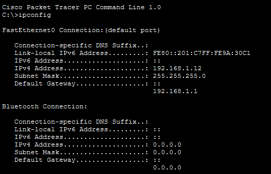
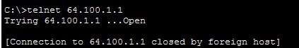

# Packet Tracer Lab: Use Telnet and SSH

## Overview

This lab demonstrates how to establish a remote connection to a router using Telnet and Secure Shell (SSH). It covers IP address verification, connectivity testing, and secure remote device access.

## Objectives

- Verify IP connectivity between a PC and a router.
- Access a router remotely using Telnet.
- Understand why Telnet access may be rejected.
- Establish a secure remote connection using SSH.

## Network Addressing

| Device | Interface | IP Address | Subnet Mask |
|---|---|---|---|
| HQ Router | G0/0/1 | 64.100.1.1 | 255.255.255.0 |
| PC0 | NIC | Assigned by DHCP | Automatically assigned |
| PC1 | NIC | Assigned by DHCP | Automatically assigned |



## Part 1: Verify Connectivity

### Step 1: Verify the PC's IP address

1. Open PC0 or PC1.
2. Select **Desktop → Command Prompt**.
3. Enter the following command:

```text
ipconfig
```

This command displays the PC's network configuration, including its IP address, subnet mask, and default gateway.

### Step 2: Test connectivity to the router

At the command prompt, enter:

```text
ping 64.100.1.1
```

The ping command sends ICMP Echo Requests to the router to check whether it is reachable.

**Expected result:** Successful replies indicate that the PC can communicate with the router. If the ping fails, check the PC's IP configuration, DHCP assignment, cabling, and router interface status.

## Part 2: Access a Remote Device

### Step 1: Attempt a Telnet connection

Enter:

```text
telnet 64.100.1.1
```

In this lab, the connection opens and is then closed by the remote host.



**Observation:** The router is configured not to allow insecure Telnet access. Telnet transmits information without encryption, so credentials and other data may be exposed.

### Step 2: Connect using SSH

Enter the following command:

```text
ssh -l admin 64.100.1.1
```

When prompted, enter the password provided by the lab instructions: `class`.


**Expected result:** After successful authentication, the router displays the privileged EXEC prompt:

```text
HQ#
```

The `HQ#` prompt indicates that you have reached privileged EXEC mode on the router.

## Commands Used

| Command | Purpose |
|---|---|
| `ipconfig` | Displays the PC's IP configuration |
| `ping 64.100.1.1` | Tests connectivity to the router |
| `telnet 64.100.1.1` | Attempts a remote connection using Telnet |
| `ssh -l admin 64.100.1.1` | Connects securely to the router using SSH |

## Telnet vs. SSH

| Feature | Telnet | SSH |
|---|---|---|
| Security | Unencrypted | Encrypted |
| Authentication details | Can be exposed | Protected in transit |
| Typical use | Legacy or controlled lab environments | Secure remote administration |
| Lab result | Connection rejected by router | Successful when credentials are correct |

## Conclusion

This lab demonstrates how to verify network connectivity and remotely access a router. The Telnet attempt is rejected because the router does not permit insecure Telnet access. SSH provides an encrypted alternative for remote administration. The successful `HQ#` prompt confirms that SSH access has been established with the required privileges.

**Key learning:** Use SSH rather than Telnet when securely administering network devices.
