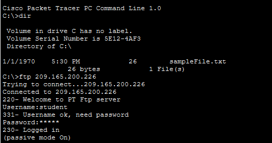
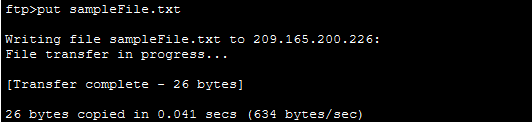
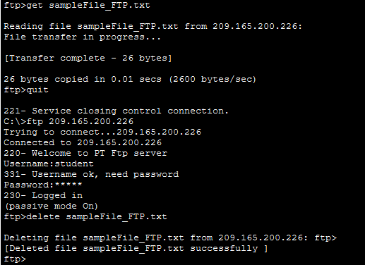

# Packet Tracer Lab: Use FTP Services

## Overview

This lab demonstrates how to use File Transfer Protocol (FTP) to upload, download, rename, list, and delete files on a remote FTP server using the command-line interface in Cisco Packet Tracer.

## Objectives

- Connect to an FTP server.
- Upload a file from a PC to the FTP server.
- Download a file from the FTP server to a PC.
- Rename and delete files on the FTP server.
- Understand basic FTP commands.

## Network Topology

The topology consists of a client PC connected to an FTP server through a network. The PC uses FTP commands to transfer files between the client and server.


## Addressing Table

| Device | Interface | IP Address | Subnet Mask |
|---|---|---|---|
| FTP Server (`ftp.pka`) | NIC | 209.165.200.226 | 255.255.255.224 |

## Part 1: Upload a File to an FTP Server

### Step 1: Locate the file

1. Click **PC-A**.
2. Open **Desktop → Command Prompt**.
3. Enter the following command:

```text
dir
```

The command lists the files stored on the PC. Locate `sampleFile.txt` in the directory.



### Step 2: Connect to the FTP server

Enter the FTP server's IP address:

```text
ftp 209.165.200.226
```

When prompted, enter the lab credentials:

- Username: `student`
- Password: `class`

After successful login, the FTP prompt appears.

### Step 3: List files on the server

Enter:

```text
dir
```

This displays the files available on the FTP server.

### Step 4: Upload the file

Enter:

```text
put sampleFile.txt
```

The `put` command uploads the local file to the FTP server. A successful transfer displays a confirmation message.



Run `dir` again to verify that the file has been uploaded.

## Part 2: Download a File from the FTP Server

### Step 1: Rename the uploaded file

At the FTP prompt, enter:

```text
rename sampleFile.txt sampleFile_FTP.txt
```

This renames the file on the server. Use `dir` to verify the new filename.

### Step 2: Download the file

Enter:

```text
get sampleFile_FTP.txt
```

The `get` command downloads the specified file from the FTP server to the PC.

After the transfer finishes, enter:

```text
quit
```

Then run `dir` at the PC command prompt to verify that the downloaded file exists locally.

## Part 3: Delete the File from the FTP Server

Reconnect to the FTP server if necessary:

```text
ftp 209.165.200.226
```

Log in using the lab credentials, then enter:

```text
delete sampleFile_FTP.txt
```

The `delete` command removes the specified file from the FTP server. Use `dir` to verify that the file is no longer listed, then enter `quit` to exit.



## Common FTP Commands

| Command | Purpose |
|---|---|
| `ftp 209.165.200.226` | Connects to the FTP server |
| `?` | Displays available FTP commands |
| `dir` | Lists files on the server or in the local directory, depending on the prompt |
| `put sampleFile.txt` | Uploads a file to the server |
| `get sampleFile_FTP.txt` | Downloads a file from the server |
| `rename sampleFile.txt sampleFile_FTP.txt` | Renames a file on the server |
| `delete sampleFile_FTP.txt` | Deletes a file from the server |
| `quit` | Exits the FTP client |

## Conclusion

This lab demonstrates the basic operations of FTP in Cisco Packet Tracer. The file `sampleFile.txt` is uploaded to the FTP server, renamed to `sampleFile_FTP.txt`, downloaded to the client PC, and deleted from the server.

**Key learning:** FTP provides commands for transferring and managing files between a client and a server. Traditional FTP does not encrypt credentials or file contents, so secure alternatives such as SFTP or FTPS should be considered in real-world environments.
