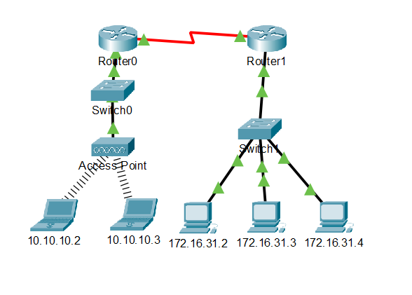
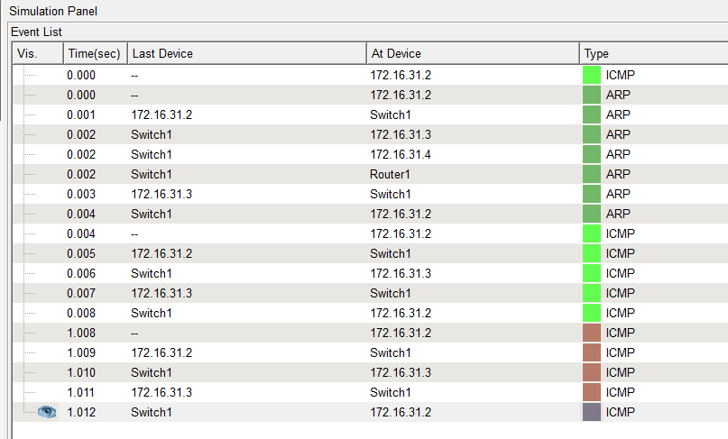
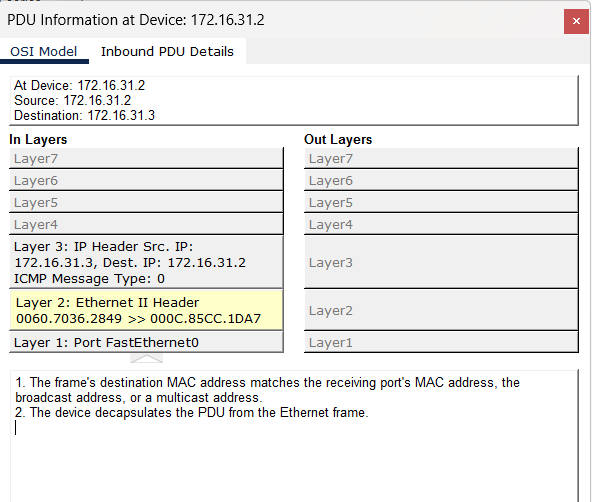
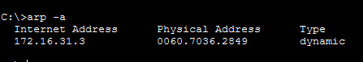
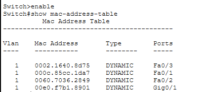
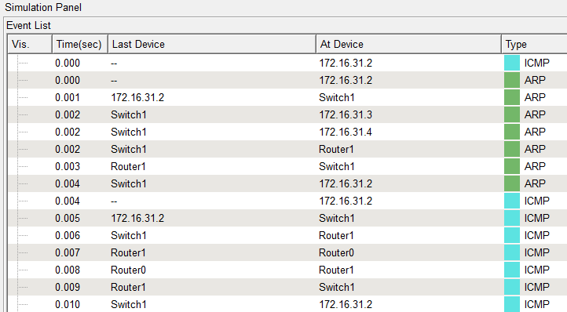

# Packet Tracer Lab: Examine the ARP Table

## Overview

This lab demonstrates how the Address Resolution Protocol (ARP) maps IPv4 addresses to MAC addresses on a local network. It also explores how switches learn MAC addresses and how ARP works when a destination is located on a remote network.

## Objectives

- Examine an ARP request and ARP reply.
- Observe how a switch forwards broadcast and unicast frames.
- View the ARP table on an end device.
- Examine a switch's MAC address table.
- Understand ARP in communication with remote networks.

## Network Topology

The topology contains routers, switches, and end devices on multiple networks. Packet Tracer Simulation Mode is used to observe ARP and ICMP packets as they travel through the network.



## Addressing Table

| Device | Interface | MAC Address | Switch Interface |
|---|---|---|---|
| Router0 | G0/0 | 0001.6458.2501 | G0/1 |
| Router0 | S0/0/0 | N/A | N/A |
| Router1 | G0/0 | 00E0.F7B1.8901 | G0/1 |
| Router1 | S0/0/0 | N/A | N/A |
| 10.10.10.2 | Wireless | 0060.2F84.4AB6 | F0/2 |
| 10.10.10.3 | Wireless | 0060.4706.572B | F0/2 |
| 172.16.31.2 | F0 | 000C.85CC.1DA7 | F0/1 |
| 172.16.31.3 | F0 | 0060.7036.2849 | F0/2 |
| 172.16.31.4 | G0 | 0002.1640.8D75 | F0/3 |


## Part 1: Examine an ARP Request

### Step 1: Generate ARP traffic

1. Open device `172.16.31.2` and select **Desktop → Command Prompt**.
2. Clear the ARP cache using:

   ```text
   arp -d
   ```

3. Switch to **Simulation Mode**.
4. Enter:

   ```text
   ping 172.16.31.3
   ```

5. Observe the generated ARP and ICMP PDUs in the Event List.
6. Click **Capture/Forward** to move the packets through the network.
7. Open the ARP PDU and examine Layer 2.



### Step 2: Examine the ARP reply

1. Continue clicking **Capture/Forward** until the ARP reply returns to `172.16.31.2`.
2. Examine the source and destination MAC addresses.
3. Return to **Realtime Mode** and allow the ping to finish.
4. On `172.16.31.2`, run:

   ```text
   arp -a
   ```

5. Verify that the ARP table contains an entry for `172.16.31.3`.



### Step 3: View the ARP table

The `arp -a` command displays the IPv4-to-MAC address mappings stored on the device.



## Part 2: Examine a Switch MAC Address Table

### Step 1: Generate additional traffic

1. From `172.16.31.2`, enter:

   ```text
   ping 172.16.31.4
   ```

2. Open device `10.10.10.2` and enter:

   ```text
   ping 10.10.10.3
   ```

3. Allow the pings to complete.

### Step 2: Inspect the switch MAC address table

1. Click **Switch1 → CLI**.
2. Enter privileged EXEC mode if required.
3. Run:

   ```text
   show mac-address-table
   ```

4. Inspect the learned MAC addresses and their associated switch ports.
5. Repeat the command on **Switch0**.



### Observation

A switch learns source MAC addresses from incoming Ethernet frames and associates them with the ports on which they were received. Multiple MAC addresses may appear on one port when multiple devices are reachable through that port, such as devices connected through an access point.

## Part 3: Examine ARP in Remote Communication

### Step 1: Generate traffic to a remote network

1. Open `172.16.31.2` and select **Desktop → Command Prompt**.
2. Enter:

   ```text
   ping 10.10.10.1
   ```

3. Run:

   ```text
   arp -a
   ```

4. Clear the ARP cache:

   ```text
   arp -d
   ```

5. Switch to Simulation Mode and repeat the ping.
6. Observe the ARP request as it travels towards the router.



### Observation

When a destination is on a different IP network, the source device does not resolve the remote device's MAC address directly. Instead, it uses ARP to discover the MAC address of its default gateway. The router then forwards the IP packet toward the destination network.

## Important Commands

| Command | Purpose |
|---|---|
| `ping 172.16.31.3` | Tests connectivity to a device on the local network |
| `arp -a` | Displays the device's ARP cache |
| `arp -d` | Clears ARP entries where supported |
| `show mac-address-table` | Displays MAC addresses learned by a switch |

## Key Concepts

- **ARP:** Resolves an IPv4 address to a MAC address on the local network.
- **ARP request:** Typically a broadcast asking which device owns an IPv4 address.
- **ARP reply:** Provides the requested MAC address, generally through a unicast response.
- **MAC address table:** A switch table mapping learned MAC addresses to switch ports.
- **Default gateway:** The router interface used to reach destinations outside the local IP network.
- **Simulation Mode:** Displays packet movement and allows inspection of protocol details.

## Results

The lab demonstrates how ARP requests and replies work, how switches learn MAC addresses, and why a device uses its default gateway's MAC address when communicating with a remote network.

## Conclusion

This activity provides practical experience with ARP, Ethernet MAC addressing, switch learning, and remote-network communication in Cisco Packet Tracer. It shows how IP addresses and MAC addresses work together to deliver traffic across a network.

**Tool:** Cisco Packet Tracer  
**Lab:** Examine the ARP Table
