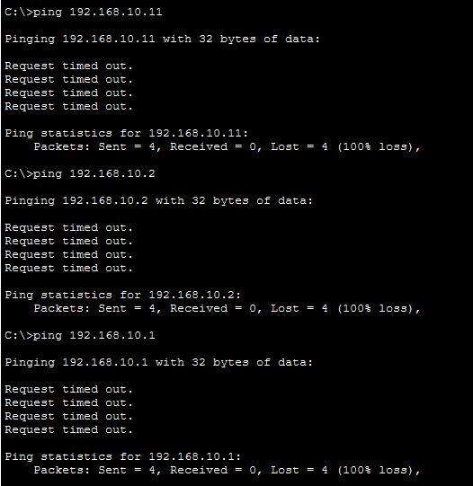
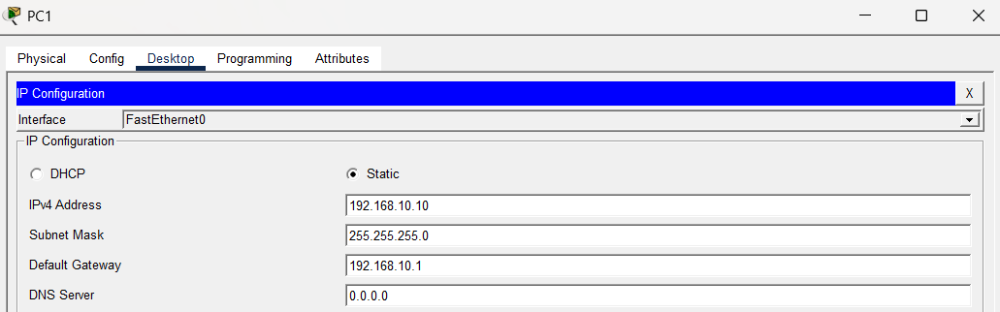
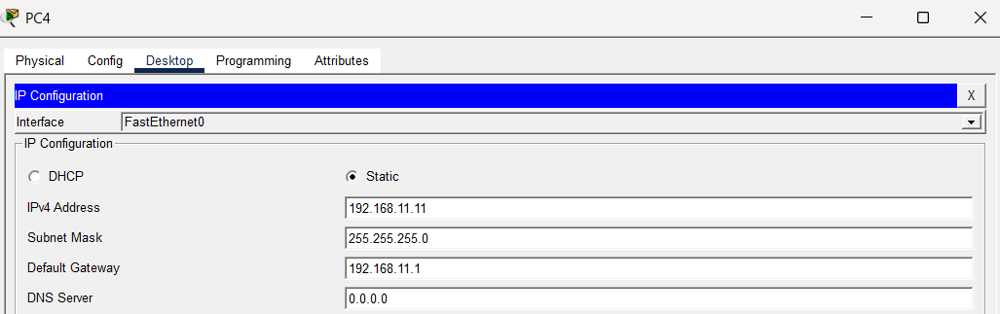
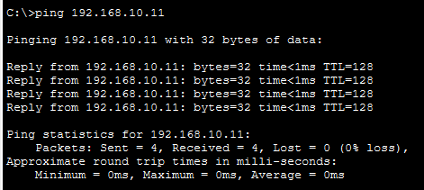

# Packet Tracer – Troubleshoot Default Gateway Issues

## 1. Overview

This lab demonstrates how to troubleshoot network connectivity problems in Cisco Packet Tracer by checking IP addresses, default gateways, and connectivity between devices.

During testing, PC1 could not reach S1 or R1, PC3 could reach S1 but not R1, and PC4 could not reach either S1 or R1. Further investigation identified an incorrect IP address on PC1 and an incorrect default gateway on PC4.

## 2. Objectives

- Test connectivity between PCs and network devices.
- Use the `ping` command to identify connectivity problems.
- Check IP configuration using `ipconfig`.
- Identify and correct an incorrect IP address.
- Identify and correct an incorrect default gateway.
- Retest connectivity after making corrections.

## 3. Tools and Commands Used

- **Cisco Packet Tracer:** Network simulation.
- **PC Command Prompt:** To check IP configuration and test connectivity.
- `ipconfig`: Displays the PC's IP configuration.
- `ping`: Tests connectivity to another device.

## 4. Network Topology

The topology used for this activity is shown below.


## 5. Initial Connectivity Testing

Before making any changes, connectivity was tested from PC1, PC3, and PC4 to S1 and R1.

### Initial Test Results

| Source Device | Test to S1 | Test to R1 |
|---|---|---|
| PC1 | Failed | Failed |
| PC3 | Passed | Failed |
| PC4 | Failed | Failed |



The initial tests showed that different devices experienced different connectivity problems. The IP configuration of the affected PCs needed to be checked.

## 6. Troubleshooting PC1

### Problem Identified

PC1 had an incorrect IP address configured.

- **Incorrect IP address:** `192.168.11.11`
- **Corrected IP address:** `192.168.10.10`

### Correction

1. Open PC1 in Cisco Packet Tracer.
2. Select **Desktop**.
3. Open **IP Configuration**.
4. Change the IP address from `192.168.11.11` to `192.168.10.10`.
5. Keep the other configuration values consistent with the lab's addressing requirements.
6. Retest connectivity to S1 and R1 using the `ping` command.

### Screenshot: Corrected PC1 Configuration



## 7. Troubleshooting PC4

### Problem Identified

PC4 had an incorrect default gateway.

- **Incorrect default gateway:** `192.168.1.1`
- **Corrected default gateway:** `192.168.11.1`

### Correction

1. Open PC4 in Cisco Packet Tracer.
2. Select **Desktop**.
3. Open **IP Configuration**.
4. Change the default gateway from `192.168.1.1` to `192.168.11.1`.
5. Keep the IP address and other configuration values consistent with the lab's addressing requirements.
6. Retest connectivity to S1 and R1 using the `ping` command.

### Screenshot: Corrected PC4 Gateway



## 8. Verification After Corrections

After correcting PC1's IP address and PC4's default gateway, repeat the connectivity tests from PC1, PC3, and PC4.

Use the following command from each PC's Command Prompt:

```text
ping <destination-IP-address>
```

Replace `<destination-IP-address>` with the actual IP address of S1 or R1.

Record the results of the new tests in the table below.

| Source Device | Test to S1 | Test to R1 |
|---|---|---|
| PC1 | Record actual result | Record actual result |
| PC3 | Record actual result | Record actual result |
| PC4 | Record actual result | Record actual result |



**Note:** Update the table with the actual results from your post-correction tests. Do not mark a test as successful unless the ping confirms connectivity.

## 9. Summary of Errors and Corrections

| Device | Configuration Error | Correction |
|---|---|---|
| PC1 | Incorrect IP address: `192.168.11.11` | Changed to `192.168.10.10` |
| PC4 | Incorrect default gateway: `192.168.1.1` | Changed to `192.168.11.1` |

PC3's test to R1 also failed during initial testing. No configuration change for PC3 was reported, so its connectivity should be checked again if the problem persists.

## 10. Result

The lab demonstrated how incorrect IP addressing and default gateway settings can cause network connectivity problems. PC1's IP address and PC4's default gateway were corrected based on the errors identified during troubleshooting.

The final connectivity results should be documented after completing the verification tests.

## 11. Conclusion

This activity provided practical experience in troubleshooting network connectivity using Cisco Packet Tracer. It highlighted the importance of configuring the correct IP address and default gateway and using commands such as `ipconfig` and `ping` to identify and verify network problems.
