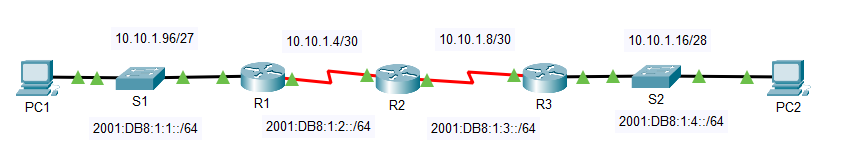
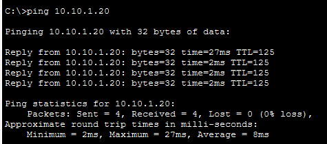
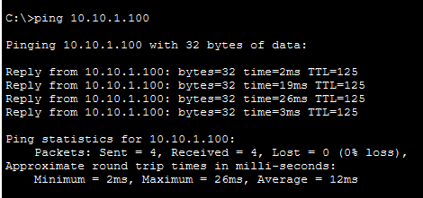
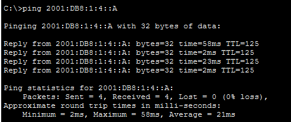
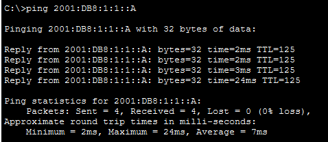
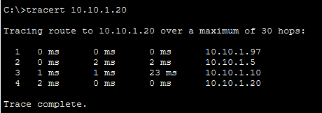
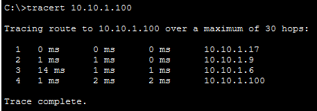
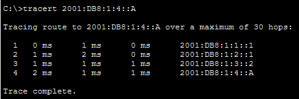
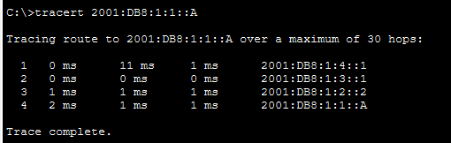

# Packet Tracer – Verify IPv4 and IPv6 Addressing

## 1. Overview

This lab demonstrates how to verify IPv4 and IPv6 addressing, test connectivity using `ping`, and discover network paths using `tracert` in Cisco Packet Tracer.

The network uses dual-stack addressing, allowing IPv4 and IPv6 to operate on the same network. Three routers (R1, R2, and R3) connect two end devices, PC1 and PC2.

## 2. Objectives

- Complete the IPv4 and IPv6 addressing table.
- Verify IPv4 configuration using `ipconfig /all`.
- Verify IPv6 configuration using `ipv6config /all`.
- Test IPv4 connectivity using `ping`.
- Test IPv6 connectivity using `ping`.
- Trace IPv4 and IPv6 routes using `tracert`.
- Identify the router interfaces encountered along each path.



## 3. Network Devices

| Device | Role |
|---|---|
| R1 | Router connected to PC1's network |
| R2 | Intermediate router |
| R3 | Router connected to PC2's network |
| S1 | Switch, if shown in the Packet Tracer topology |
| PC1 | First end device |
| PC2 | Second end device |

## 4. Addressing Table

### IPv4 and IPv6 Router Addresses

| Device | Interface | IP Address / Prefix | Subnet Mask |
|---|---|---|---|
| R1 | G0/0 | `10.10.1.97` | `255.255.255.224` |
| R1 | G0/0 | `2001:db8:1:1::1/64` | — |
| R1 | S0/0/1 | `10.10.1.6` | `255.255.255.252` |
| R1 | S0/0/1 | `2001:db8:1:1::1/64` | — |
| R1 | S0/0/1 | `fe80::1` | — |
| R2 | S0/0/0 | `10.10.1.5` | `255.255.255.252` |
| R2 | S0/0/0 | `2001:db8:1:2::1/64` | — |
| R2 | S0/0/1 | `10.10.1.9` | `255.255.255.252` |
| R2 | S0/0/1 | `2001:db8:1:3::1/64` | — |
| R2 | S0/0/1 | `fe80::2` | — |
| R3 | G0/0 | `10.10.1.17` | `255.255.255.240` |
| R3 | G0/0 | `2001:db8:1:4::1/64` | — |
| R3 | S0/0/1 | `10.10.1.10` | `255.255.255.252` |
| R3 | S0/0/1 | `2001:db8:1:3::2/64` | — |
| R3 | S0/0/1 | `fe80::3` | — |

**Note:** The router addressing entries above follow the supplied activity screenshot. Check the actual interface assignments in Packet Tracer if any entry appears inconsistent.

### End Device Addresses

| Device | IP Version | IP Address / Prefix | Subnet Mask | Default Gateway |
|---|---|---|---|---|
| PC1 | IPv4 | `10.10.1.100` | `255.255.255.224` | `10.10.1.97` |
| PC1 | IPv6 | `2001:db8:1:1::a/64` | — | `fe80::1` |
| PC2 | IPv4 | `10.10.1.20` | `255.255.255.240` | `10.10.1.17` |
| PC2 | IPv6 | `2001:db8:1:4::a/64` | — | `fe80::3` |

## 5. Part 1 – Complete the Addressing Table

### Step 1: Verify IPv4 Addressing

1. Click PC1 and open **Desktop → Command Prompt**.
2. Enter the command:

   ```text
   ipconfig /all
   ```

3. Record PC1's IPv4 address, subnet mask, and default gateway.
4. Repeat the same steps on PC2.
5. Compare the results with the addressing table.

### Step 2: Verify IPv6 Addressing

1. Open the Command Prompt on PC1.
2. Enter:

   ```text
   ipv6config /all
   ```

3. Record PC1's IPv6 address, prefix, and default gateway.
4. Repeat the command on PC2.
5. Complete the IPv6 entries in the addressing table.

## 6. Part 2 – Test Connectivity Using Ping

### Step 1: Test IPv4 Connectivity

From PC1, ping PC2's IPv4 address:

```text
ping 10.10.1.20
```

From PC2, ping PC1's IPv4 address:

```text
ping 10.10.1.100
```

**Result:** Both tests are marked successful in the supplied activity screenshots.




### Step 2: Test IPv6 Connectivity

From PC1, ping PC2's IPv6 address:

```text
ping 2001:db8:1:4::a
```

From PC2, ping PC1's IPv6 address:

```text
ping 2001:db8:1:1::a
```

**Result:** Both tests are marked successful in the supplied activity screenshots.




## 7. Part 3 – Discover the Path by Tracing the Route

### Step 1: Trace the IPv4 Route

#### A. From PC1 to PC2

Run the following command on PC1:

```text
tracert 10.10.1.20
```

The supplied activity shows these addresses along the path:

1. `10.10.1.97` – R1, G0/0
2. `10.10.1.5` – R2, S0/0/0
3. `10.10.1.10` – R3, S0/0/1
4. `10.10.1.20` – PC2, NIC



#### B. From PC2 to PC1

Run this command on PC2:

```text
tracert 10.10.1.100
```

The supplied activity shows these addresses along the path:

1. `10.10.1.17` – R3, G0/0
2. `10.10.1.9` – R2, S0/0/1
3. `10.10.1.6` – R1, S0/0/1
4. `10.10.1.100` – PC1, NIC



### Step 2: Trace the IPv6 Route

#### A. From PC1 to PC2

Run this command on PC1:

```text
tracert 2001:db8:1:4::a
```

The supplied activity shows these addresses along the path:

1. `2001:db8:1:1::1` – R1, G0/0
2. `2001:db8:1:2::1` – R2, S0/0/0
3. `2001:db8:1:3::2` – R3, S0/0/1
4. `2001:db8:1:4::a` – PC2, NIC



#### B. From PC2 to PC1

Run this command on PC2:

```text
tracert 2001:db8:1:1::a
```

The supplied activity shows these addresses along the path:

1. `2001:db8:1:4::1` – R3, G0/0
2. `2001:db8:1:3::1` – R2, S0/0/1
3. `2001:db8:1:2::2` – R1, S0/0/1
4. `2001:db8:1:1::a` – PC1, NIC



## 8. Important Commands

| Command | Purpose |
|---|---|
| `ipconfig /all` | Displays IPv4 configuration information |
| `ipv6config /all` | Displays IPv6 configuration information |
| `ping <IP-address>` | Tests connectivity to a destination |
| `tracert <IP-address>` | Displays the route taken to reach a destination |

## 9. Observations

- IPv4 and IPv6 can operate on the same network using dual-stack addressing.
- The `ping` command verifies whether two devices can communicate.
- The `tracert` command displays the intermediate addresses encountered along a route.
- Traffic between PC1 and PC2 passes through R1, R2, and R3.
- The forward and reverse paths use different router interfaces and addresses.
- IPv6 link-local addresses are used as default gateways in the supplied end-device configuration.

## 10. Result

The IPv4 and IPv6 addressing information was documented, connectivity between PC1 and PC2 was tested successfully for both protocols, and the IPv4 and IPv6 routes were traced in both directions.

## 11. Conclusion

This lab demonstrated how to verify IPv4 and IPv6 addressing, test end-to-end connectivity, and identify the network path between two end devices. Commands such as `ipconfig /all`, `ipv6config /all`, `ping`, and `tracert` help troubleshoot and understand dual-stack networks.
